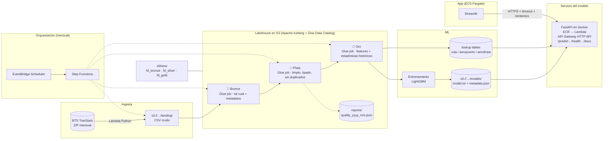
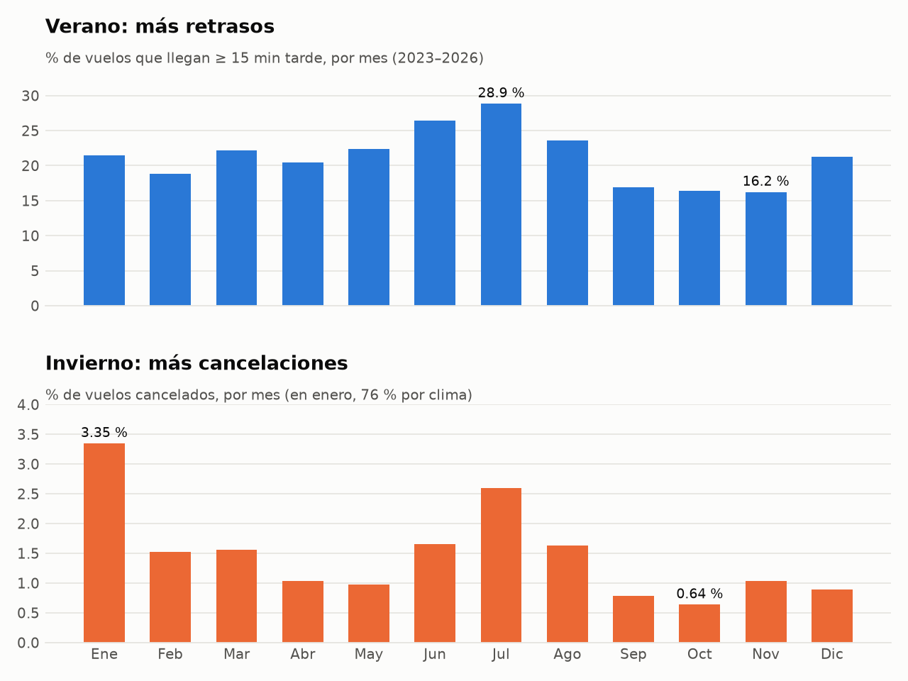
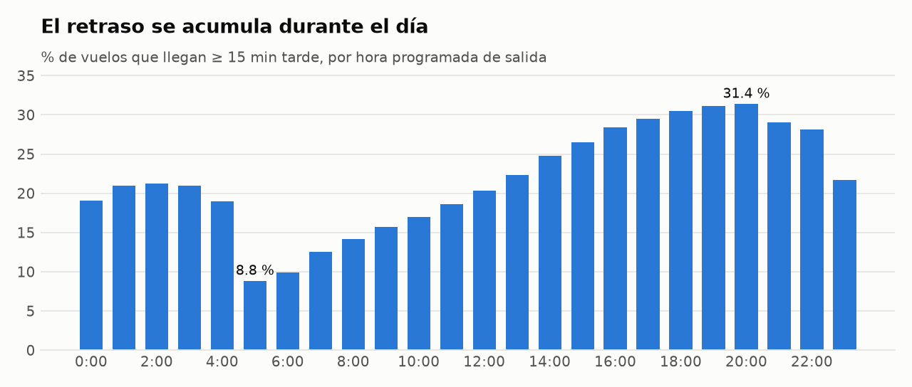
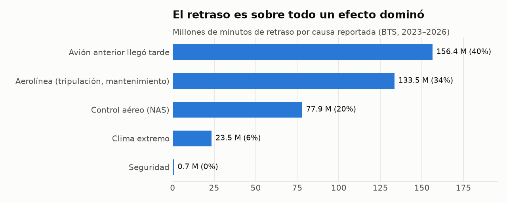
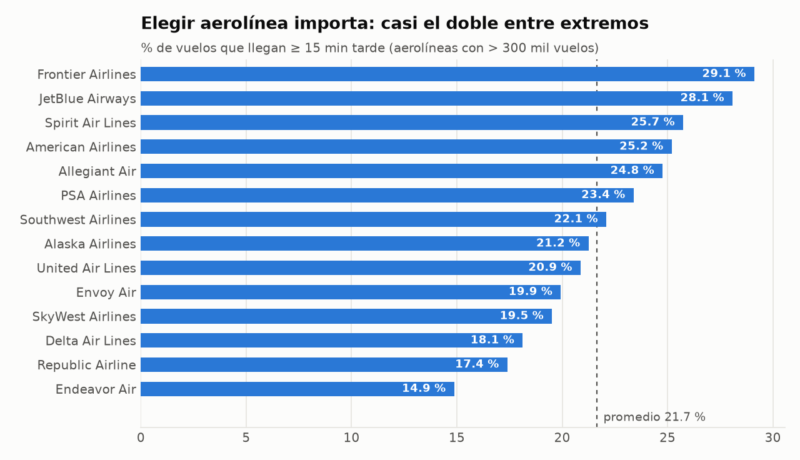
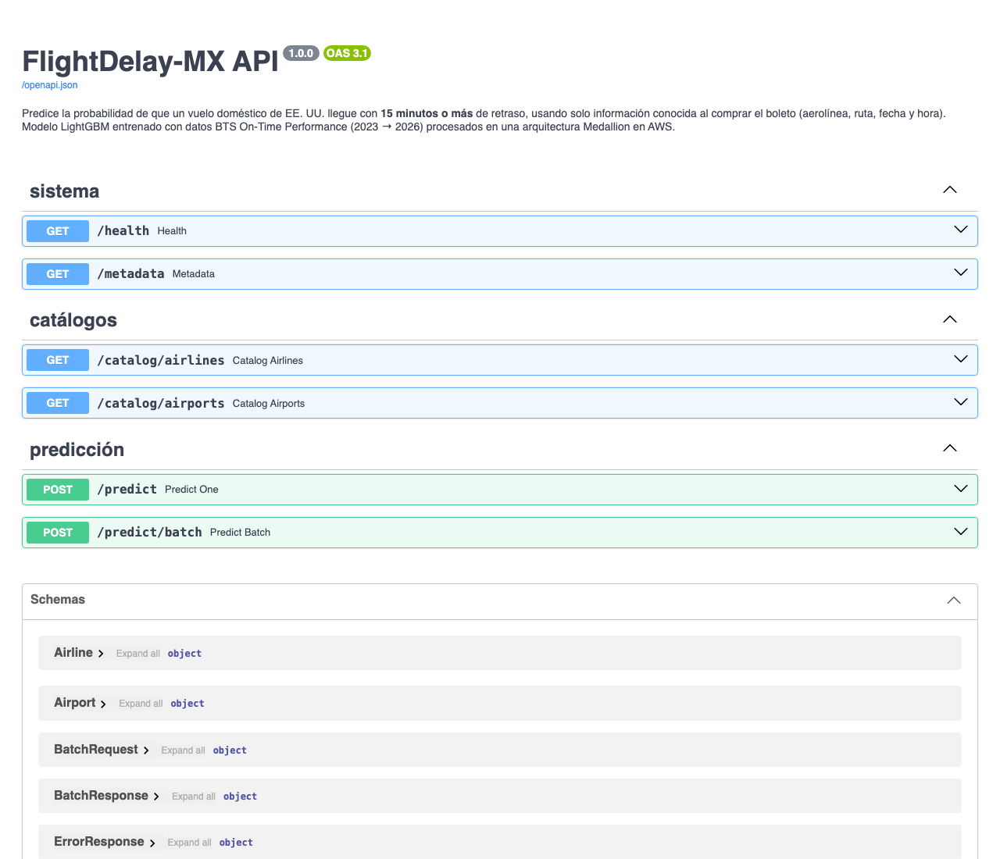
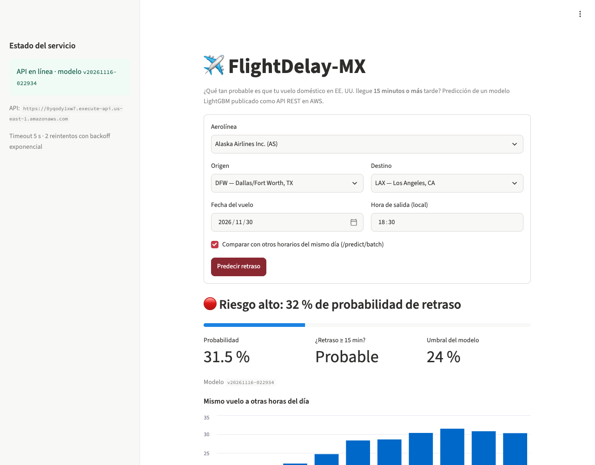

# ✈️ FlightDelay-MX — Predicción de retrasos en vuelos con Spark, Medallion y FastAPI en AWS

> Pipeline de datos de punta a punta en AWS: ingesta mensual automatizada de **25.7 millones de vuelos** (ene 2023 – ago 2026), arquitectura Medallion (Bronce → Plata → Oro) con jobs de PySpark en AWS Glue sobre tablas Apache Iceberg, modelo de clasificación publicado como API REST y una aplicación web que lo consume.

**Materia:** _[Nombre de la materia]_ · **Universidad Panamericana** · **Maestría en Ciencia de Datos e Innovación Tecnológica de Negocios**
**Autor(es):** _[Nombre(s)]_ · **Fecha de presentación:** noviembre 2026

---

## Tabla de contenido

1. [Descripción del proyecto](#1-descripción-del-proyecto)
2. [Arquitectura](#2-arquitectura)
3. [Fuente de datos](#3-fuente-de-datos)
4. [Pipeline Medallion: limpieza y transformación](#4-pipeline-medallion-limpieza-y-transformación)
5. [Definición del problema y métricas](#5-definición-del-problema-y-métricas)
6. [Publicación del modelo (API)](#6-publicación-del-modelo-api)
7. [Aplicación de consulta](#7-aplicación-de-consulta)
8. [Estructura del repositorio](#8-estructura-del-repositorio)
9. [Cómo ejecutarlo](#9-cómo-ejecutarlo)
10. [Resultados](#10-resultados)
11. [Costos](#11-costos)
12. [Limitaciones y trabajo futuro](#12-limitaciones-y-trabajo-futuro)
13. [Referencias](#13-referencias)

---

## 1. Descripción del proyecto

Entre 1 de cada 5 y 1 de cada 4 vuelos domésticos en EE.UU. llega con 15 minutos o más de retraso (en la muestra de agosto 2026, el **26.9 %**). Este proyecto responde una pregunta concreta:

> **Al momento de comprar un boleto, ¿qué tan probable es que el vuelo llegue con retraso?**

El sistema:

1. **Descarga cada mes** los datos oficiales de puntualidad de la Bureau of Transportation Statistics (BTS) con un job programado (EventBridge Scheduler → Step Functions → Lambda).
2. **Procesa** los datos con **PySpark en AWS Glue** usando la **arquitectura Medallion** sobre tablas **Apache Iceberg**, consultables con **Athena**.
3. **Entrena** un clasificador con variables conocidas *antes* del vuelo (sin fuga de datos).
4. **Publica** el modelo como una **API REST en FastAPI**, contenerizada con **Docker** y servida en **AWS Lambda + API Gateway**, documentada con **Swagger/OpenAPI**.
5. **Expone** una **aplicación web** (Streamlit en ECS Fargate) donde el usuario elige aerolínea, ruta, fecha y hora, y recibe la probabilidad de retraso.

| Requisito del curso | Cómo se cumple |
|---|---|
| ≥ 4 millones de registros | Ene 2023 – ago 2026: 44 meses, **25,657,311 registros** procesados (6.4× el mínimo) |
| Pipelines / ETL / jobs | Lambda de ingesta + un Glue job de Spark por capa, orquestados con **Step Functions** y disparados cada mes por **EventBridge Scheduler** |
| Arquitectura Medallion | Bronce (crudo) → Plata (limpio) → Oro (features) en **Apache Iceberg** sobre S3 |
| Spark | PySpark (AWS Glue 5.0) para toda la transformación |
| Modelo de ML publicado | LightGBM servido por FastAPI en una imagen Docker (ECR → Lambda) detrás de API Gateway |
| Capa de resultados | Aplicación web (Streamlit) que consume el endpoint publicado |

---

## 2. Arquitectura



**Decisiones clave**

- La app **nunca carga el modelo localmente**: toda predicción pasa por el endpoint HTTP publicado. La API carga el modelo y las tablas de consulta desde S3 al arrancar.
- **Iceberg** en vez de Parquet plano: escrituras idempotentes por partición (`overwritePartitions`), evolución de esquema y consultas directas desde Athena.
- **Step Functions + EventBridge** en vez de Airflow administrado (MWAA): sin costo fijo; se paga por transición de estado.
- **Lambda + API Gateway** en vez de un endpoint de SageMaker: el modelo es ligero y el tráfico de una demo es mínimo; sin costo fijo.

| Capa | Servicio de AWS |
|---|---|
| Almacenamiento | S3: `landing/`, `bronze/`, `silver/`, `gold/`, `models/`, `reports/` |
| Formato de tablas | Apache Iceberg |
| Catálogo y SQL | Glue Data Catalog + Athena (`fd_bronze`, `fd_silver`, `fd_gold`) |
| Ingesta | Lambda (Python) |
| Transformación | AWS Glue 5.0 (PySpark), un job por capa, workers `G.1X` |
| Orquestación | Step Functions + EventBridge Scheduler |
| API del modelo | FastAPI + Mangum en imagen Docker → ECR → Lambda + API Gateway HTTP API |
| App | Streamlit en Docker → ECS Fargate |
| Infraestructura | Terraform (`infra/terraform/`) |

---

## 3. Fuente de datos

| Atributo | Detalle |
|---|---|
| **Fuente** | [BTS — Reporting Carrier On-Time Performance (1987–presente)](https://www.transtats.bts.gov/Tables.asp?QO_VQ=EFD) |
| **Proveedor** | U.S. Department of Transportation — Bureau of Transportation Statistics |
| **Descarga** | Un ZIP por mes: `https://transtats.bts.gov/PREZIP/On_Time_Reporting_Carrier_On_Time_Performance_1987_present_{YYYY}_{M}.zip` (mes sin cero a la izquierda). Verificado el 15 nov 2026 |
| **Granularidad** | 1 registro = 1 vuelo doméstico operado por una aerolínea reportante |
| **Periodo usado** | Enero 2023 – agosto 2026 (último mes publicado al 15 nov 2026) |
| **Volumen** | **25,657,311 registros**; 11.6 GB en CSV (landing) → 0.73 GB en Iceberg/Parquet zstd (bronce) |
| **Formato** | CSV dentro de ZIP; 109 columnas con nombre + 1 columna vacía por la coma final; todos los valores entre comillas; numéricos con decimales (`"0.00"`) |
| **Frecuencia** | Mensual, con ~2–3 meses de rezago |
| **Licencia** | Dominio público (gobierno de EE.UU.) |

**Muestra verificada (agosto 2026):** 608,389 vuelos · ZIP de 32 MB · CSV de 263 MB · 11,313 cancelados · 2,869 desviados · 26.9 % de retrasos entre los vuelos que llegaron.

**Definición oficial de "a tiempo":** el vuelo llega menos de 15 minutos después de la hora programada. Esta regla define la variable objetivo `ArrDel15`.

### Columnas seleccionadas

| Grupo | Columnas | ¿Se usa como feature? |
|---|---|---|
| Fecha | `FlightDate`, `Year`, `Month`, `DayofMonth`, `DayOfWeek` | ✅ |
| Aerolínea | `Reporting_Airline`, `Flight_Number_Reporting_Airline`, `Tail_Number` | ✅ aerolínea / ❌ cola y número (identificadores) |
| Ruta | `Origin`, `Dest`, `OriginState`, `DestState`, `Distance` | ✅ |
| Horario programado | `CRSDepTime`, `CRSArrTime`, `CRSElapsedTime` | ✅ |
| Horario real | `DepTime`, `DepDelay`, `DepDelayMinutes`, `DepDel15`, `DepartureDelayGroups`, `TaxiOut`, `WheelsOff`, `WheelsOn`, `TaxiIn`, `ArrTime`, `ActualElapsedTime`, `AirTime` | ❌ **fuga de datos** |
| Resultado | `ArrDelay`, `ArrDelayMinutes`, `ArrDel15`, `ArrivalDelayGroups`, `Cancelled`, `CancellationCode`, `Diverted` | 🎯 objetivo / filtro |
| Causas | `CarrierDelay`, `WeatherDelay`, `NASDelay`, `SecurityDelay`, `LateAircraftDelay` | ❌ **fuga de datos** (solo para análisis) |
| Desvíos y tiempo extra en tierra | `Div*` (≈ 60 columnas), `FirstDepTime`, `TotalAddGTime`, `LongestAddGTime` | ❌ **fuga de datos** |

La lista de columnas permitidas y prohibidas vive en un solo lugar: [`src/gold/feature_config.py`](src/gold/feature_config.py). [`tests/test_feature_config.py`](tests/test_feature_config.py) falla si una columna prohibida entra al modelo, sin importar la convención de nombres (`DepDelay` = `dep_delay`).

---

## 4. Pipeline Medallion: limpieza y transformación

Cada capa es un **Glue job de PySpark**. Las transformaciones viven en funciones puras (`DataFrame -> DataFrame`) en `src/`, con tests unitarios en PySpark local; el script del job solo lee, llama a esas funciones y escribe.

### 🥉 Bronce — "lo que llegó, tal cual"

**Objetivo:** tener una copia inmutable y auditable de la fuente.

- La **Lambda de ingesta** ([`src/ingestion/handler.py`](src/ingestion/handler.py)) descarga el ZIP del mes y sube el CSV **en streaming** (sin descomprimir a disco) a `s3://<bucket>/landing/year=YYYY/month=MM/bts_YYYY_MM.csv`. Al terminar escribe `_manifest.json` con la URL de origen, bytes y **conteo de filas**; ese manifiesto es la marca de "mes completo" (idempotencia: si existe, no se vuelve a descargar) y el conteo contra el que bronce valida que no perdió filas.
  - Sin mes en el evento, prueba hacia atrás (HEAD) hasta encontrar el último mes publicado; BTS responde 404 a los meses aún no publicados.
  - Siempre devuelve `status` = `ingested` / `already_ingested` / `not_published` para que Step Functions decida con un `Choice` en vez de tratar "aún no hay datos" como error.
  - Medido en AWS (ago 2026): **608,389 filas, 276 MB, 18 s, 244 MB de RAM** (arm64, 1 GB).
- El **Glue job `flightdelay-mx-bronze`** ([`bronze_job.py`](src/glue_jobs/bronze_job.py) orquesta; la lógica está en funciones puras en [`bronze.py`](src/glue_jobs/bronze.py), con tests en PySpark local) lee el CSV y lo escribe en la tabla Iceberg `fd_bronze.flights_raw`. Parámetro `--year_months`: un mes (`2026-08`), lista o rango (`2023-01:2026-08`).

| Decisión en bronce | Justificación |
|---|---|
| Todas las columnas como `string` (`inferSchema=false`) | Inferir tipos escondería errores de formato que plata debe ver y contar; conserva ceros a la izquierda (`"0530"`) y los numéricos como llegan (`"0.00"`) |
| Se elimina `_c109` (columna sin encabezado por la coma final) | Antes se verifica que esté 100 % vacía; si algún día trae datos, el job falla en vez de perderlos |
| Nombres en minúsculas | Glue Catalog y Athena guardan los nombres en minúsculas; así el esquema Iceberg y el del catálogo coinciden |
| Campos vacíos → `null` | Comportamiento por defecto del lector CSV de Spark; BTS no distingue "vacío" de "desconocido" |
| Lectura `FAILFAST` | Una línea malformada detiene el job en vez de descartarse en silencio |
| Conteo validado contra `_manifest.json` | Garantiza que no se perdió ni duplicó ninguna fila entre landing y bronce |
| Esquema alineado con la tabla existente | Si BTS agrega o quita columnas, el job falla con un mensaje claro en lugar de escribir datos desalineados |
| Metadatos `_source_file`, `_ingested_at`, `_year`, `_month` | Linaje: cada fila se rastrea hasta su archivo y corrida |
| Particionado por `_year`, `_month`; `overwritePartitions()` | **Idempotente:** reprocesar un mes reemplaza solo su partición |

**Medido en AWS (ago 2026, Glue 5.0, 2 × G.1X):**

| | Valor |
|---|---|
| Filas landing → bronce | 608,389 → 608,389 (validado contra manifiesto) |
| Columnas | 109 de BTS + 4 de linaje = 113 |
| Tamaño | CSV 276 MB → Iceberg/Parquet zstd **18 MB** |
| Duración / costo | ~2 min, 240 DPU-s ≈ USD 0.03 |
| Re-ejecución del mismo mes | Snapshot `overwrite`: −608,389 / +608,389 → conteo sin cambios (sin duplicados) |

Cada corrida deja `reports/bronze/bronze_YYYY_MM.json` con los conteos.

### 🥈 Plata — "limpio y confiable"

Cada decisión de limpieza está documentada y justificada. Las cifras de evidencia vienen de la muestra de agosto 2026 (608,389 filas).

| Problema | Tratamiento | Justificación |
|---|---|---|
| **Tipos de dato** | Cast de `string` a `int`/`double`/`date`. Los numéricos llegan como `"0.00"`: se castean a `double` y luego a `int` cuando corresponde (`ArrDel15`, `Cancelled`) | La fuente exporta todo como texto con decimales |
| **Hora programada** | `CRSDepTime` (`"0006"`…`"2359"`) → `dep_hour`, `dep_minute` y `scheduled_dep_local` (`TIMESTAMP_NTZ`). Se acepta también sin ceros a la izquierda (`530`), y `2400` → `00:00` del día siguiente. Hora fuera de rango (hh > 23 o mm > 59) → descarte `invalid_crs_dep_time` | En la muestra viene con 4 dígitos (rango `0006`–`2359`, sin `2400`), pero la documentación de BTS admite `2400` y años anteriores traen formatos sin relleno; la función de parseo cubre los tres casos. Se guarda como timestamp **sin zona** porque BTS da la hora local del aeropuerto sin zona horaria; con `timestamp` normal Spark la desplazaría según la zona de la sesión (bug detectado por los tests) |
| **Duplicados** | Una fila por llave `FlightDate + Reporting_Airline + Flight_Number_Reporting_Airline + Origin + Dest + CRSDepTime`; se conserva la ingerida más recientemente (`row_number` sobre `_ingested_at`), así el resultado es determinista | Al recargar meses o mezclar archivos pueden repetirse vuelos. En ago 2026: 0 duplicados, pero la regla queda auditada en el reporte |
| **Nulos en `ArrDelay` / `ArrDel15`** | Vuelos `Cancelled = 1` o `Diverted = 1` se **separan** a `fd_silver.flights_disrupted` y se excluyen del modelo | En la muestra, los 14,182 nulos de `ArrDel15` son **exactamente** 11,313 cancelados + 2,869 desviados. No son errores: el vuelo no llegó. Mezclarlos con "retraso" cambiaría la definición del problema |
| **Nulos en causas de retraso** | Imputación con `0` | En la muestra, las causas tienen valor en **exactamente** 159,636 filas, que son todos los vuelos con `ArrDel15 = 1`. Los 448,753 nulos = 434,571 vuelos a tiempo + 14,182 que no llegaron. Nulo significa "0 minutos atribuibles", no dato faltante |
| **Nulos en `Tail_Number`** | Se rellenan con `"UNKNOWN"` | 1,338 nulos (0.2 %), **todos en vuelos cancelados** (avión nunca asignado): en `flights` hay 0. No es feature; se conserva para trazabilidad |
| **Outliers en `ArrDelay`** | Se conservan para la etiqueta binaria. Para análisis descriptivo se marca `is_extreme_delay` si `ArrDelay > P99.9` | Un retraso de 10 horas es real y sigue siendo "retraso"; eliminarlo sesgaría la clase positiva |
| **Valores imposibles y registros inutilizables** | 6 reglas de descarte, en orden, cada fila con su motivo: `missing_key` (falta un campo de la llave o la fecha no se puede parsear), `invalid_crs_dep_time`, `non_positive_distance`, `non_positive_crs_elapsed`, `origin_equals_dest`, `missing_target` (vuelo completado sin `ArrDel15`) | Errores de captura o filas que no se pueden identificar ni etiquetar. En ago 2026 ninguna regla se activa (0 descartes), pero protegen los 44 meses y quedan contadas por regla en el reporte |
| **Fallas de cast** | Un valor presente que no castea (p. ej. `"abc"` en `Distance`) queda `null` y se **cuenta por columna** en el reporte; después lo atrapa la regla de descarte correspondiente | Ningún valor se pierde en silencio. En ago 2026: 0 fallas |
| **Columnas sin uso** | Selección **explícita** de 42 columnas (de 109): fuera `Div1*`–`Div5*`, `FirstDepTime`, `TotalAddGTime`, `LongestAddGTime` y los derivados `*Group`/`*Minutes` | `Div3*`–`Div5*` están 100 % vacías en la muestra y el resto solo aplica a desviados o regresos a puerta. Seleccionar explícitamente (en vez de "tirar las columnas vacías del mes") mantiene el esquema de la tabla Iceberg estable entre meses |
| **Catálogos** | Left join (broadcast) con `L_UNIQUE_CARRIERS` por código de aerolínea y `L_AIRPORT_ID` por `OriginAirportID`/`DestAirportID`. Código sin catálogo → `"UNKNOWN"` y se cuenta; **no** se elimina el vuelo. Se publican como `fd_silver.airlines` (1,780) y `fd_silver.airports` (6,918) | Nombres legibles para la app y la API. Se usa el ID numérico de aeropuerto y no el código IATA porque los IATA se han reasignado con los años. En ago 2026: 0 códigos sin catálogo |

**Control de calidad:** cada corrida genera `s3://<bucket>/reports/quality_<yyyy_mm>.json` con conteos de entrada y salida, nulos por columna, fallas de cast, descartes por regla, duplicados, imputaciones, filas sin catálogo, tasa de positivos y umbral de retraso extremo. Incluye una **conciliación**: `entrada = descartes + duplicados + vuelos + interrumpidos`; si no cuadra, el job falla.

**Medido en AWS (ago 2026, Glue 5.0, 2 × G.1X, ~2 min, ≈ USD 0.03):**

| | Filas |
|---|---|
| Entrada (`fd_bronze.flights_raw`) | 608,389 |
| Descartes (6 reglas) / duplicados | 0 / 0 |
| → `fd_silver.flights` (para el modelo) | **594,207** |
| → `fd_silver.flights_disrupted` | **14,182** (11,313 cancelados: A 3,119 · B 5,274 · C 2,920; 2,869 desviados) |
| Conciliación | 608,389 = 0 + 0 + 594,207 + 14,182 ✅ |
| Positivos `arr_del15` | 159,636 (**26.87 %**); 0 inconsistencias entre `arr_del15` y `arr_delay ≥ 15` |
| Causas de retraso imputadas a 0 | 434,571 por causa |
| Retraso extremo (P99.9 = 837 min) | 612 marcados y conservados; rango de `arr_delay`: −93 a 4,381 min |

Primera señal para el modelo (Athena): los vuelos programados a las 6:00 llegan tarde el **9.1 %** de las veces; a las 18:00, el **40.2 %**.

### 🥇 Oro — "listo para el modelo y para la API"

**`fd_gold.features_flights`**: una fila por vuelo con:

| Feature | Tipo | Descripción |
|---|---|---|
| `airline` | categórica | Código de aerolínea |
| `origin_te`, `dest_te` | numérica | Aeropuertos (~350 valores) con *target encoding* suavizado (k = 50), **expansivo por mes**: un vuelo de marzo solo ve enero y febrero |
| `dep_hour_sin`, `dep_hour_cos` | numérica | Hora programada codificada cíclicamente |
| `month_sin`, `month_cos` | numérica | Mes codificado cíclicamente (estacionalidad) |
| `day_of_week` | categórica | Lunes … domingo |
| `distance` | numérica | Millas |
| `crs_elapsed_time` | numérica | Duración programada (minutos) |
| `days_to_holiday` | numérica | Días al feriado federal más cercano (antes o después), tope 30 |
| `route_delay_rate_30d` | numérica | % de retrasos de la ruta en la ventana **[d−30, d−1]** (el día del vuelo no se incluye), suavizado hacia la tasa global de la misma ventana (k = 20) |
| `origin_delay_rate_30d` | numérica | % de retrasos del aeropuerto de origen, misma lógica |
| `airline_delay_rate_30d` | numérica | % de retrasos de la aerolínea, misma lógica |
| `arr_del15` | **objetivo** | 1 si llegó con ≥ 15 min de retraso |

**Cómo se evita la fuga de datos en oro** ([`src/glue_jobs/gold.py`](src/glue_jobs/gold.py), probado en [`tests/test_gold.py`](tests/test_gold.py)):

| Decisión | Justificación |
|---|---|
| Ventanas de 30 días `rangeBetween(-30, -1)` por día | Al comprar el boleto no se conoce el resultado de los vuelos de ese mismo día ni de días posteriores |
| Suavizado `(retrasos + k·prior) / (vuelos + k)` | Una ruta con 3 vuelos no salta entre 0 % y 100 %; con pocos datos tiende a la media global |
| *Target encoding* expansivo por mes (no "con todo el entrenamiento") | Calcularlo con todo el set de entrenamiento mete la etiqueta de cada fila en su propia feature (fuga dentro del entrenamiento). El expansivo solo usa meses anteriores |
| Ene 2023 = calentamiento | Sin meses previos, su TE es nulo; el entrenamiento empieza en feb 2023 |
| Fórmulas deterministas compartidas ([`src/gold/features.py`](src/gold/features.py)) | La API calcula hora/mes cíclicos y días al feriado con **las mismas funciones** que oro; un test compara Spark contra Python para evitar *training/serving skew* |
| Recalculo completo en cada corrida | Las features dependen de toda la historia; con 25.2 M de filas tarda 4.6 min (4 × G.1X) e Iceberg conserva el snapshot anterior |

**Lookups para la API** (`fd_gold.lookup_route`, `lookup_origin`, `lookup_dest`, `lookup_airline`, `lookup_global`): las mismas estadísticas evaluadas al cierre de los datos (tasas de los últimos 30 días, TE con toda la historia, distancia y duración típicas de cada ruta, nombres de aeropuertos y aerolíneas). El entrenamiento las empaqueta junto al modelo (`lookups.json`), así la API construye las features con solo aerolínea, ruta, fecha y hora.

---

## 5. Definición del problema y métricas

| Elemento | Definición |
|---|---|
| **Tipo de tarea** | Clasificación binaria supervisada |
| **Variable objetivo** | `ArrDel15` (1 = llegó ≥ 15 min tarde) |
| **Momento de predicción** | Al comprar el boleto: solo se usa información conocida **antes** del vuelo |
| **Desbalance** | Periodo completo: **78.3 % clase 0 / 21.7 % clase 1** (5,457,119 retrasos en 25,196,995 vuelos). Varía por mes de 13.2 % (oct 2024) a 29.6 % (jul 2024) |

### Métrica principal: **F1-score de la clase positiva**

Con 78/22, un modelo que siempre responde "a tiempo" tiene **76.7 % de accuracy en prueba** y no detecta un solo retraso (F1 = 0). F1 balancea:

- **Precision:** de los vuelos que marcamos como "retrasados", ¿cuántos lo estuvieron?
- **Recall:** de los vuelos que se retrasaron, ¿cuántos detectamos?

**Métricas secundarias:** PR-AUC (independiente del umbral, apropiada con desbalance), ROC-AUC (comparabilidad) y la matriz de confusión.

**Umbral de decisión:** se elige el umbral que maximiza F1 en validación, en lugar de usar 0.5 por defecto, y se guarda en `metadata.json`.

### Validación sin fuga de datos

- **Partición temporal:** calentamiento ene 2023 · entrenamiento feb 2023 – jun 2025 · validación jul – sep 2025 (early stopping y umbral) · prueba oct 2025 – ago 2026 (se evalúa una sola vez). **No** se usa split aleatorio: el modelo se evalúa sobre meses que nunca vio, como pasaría en producción.
- Columnas post-vuelo (`DepDelay`, `TaxiOut`, causas, `Div*`, etc.) **excluidas explícitamente** en [`src/gold/feature_config.py`](src/gold/feature_config.py), con un test que lo garantiza.
- Las tasas históricas usan ventanas que terminan el día **anterior** al vuelo, y el *target encoding* solo ve meses **anteriores** (ver Oro).
- La matriz de features se construye con **una sola función** ([`src/ml/matrix.py`](src/ml/matrix.py)) en el entrenamiento y en la API, que además llama a `assert_no_leakage()`.

### Modelos comparados

| Modelo | Rol |
|---|---|
| Baseline "siempre a tiempo" | Piso de referencia (F1 = 0) |
| Regresión logística | Baseline interpretable |
| **LightGBM** | Modelo final: maneja categóricas, rápido y ligero para servir |

> **¿Por qué LightGBM y no Spark MLlib para servir?** Servir un modelo de MLlib requiere levantar una sesión de Spark dentro de la API (segundos de arranque y mucha memoria, inviable en Lambda). Spark se usa para el procesamiento masivo; el modelo final se entrena sobre la tabla Oro y se exporta como un artefacto ligero para inferencia con baja latencia.

---

## 6. Publicación del modelo (API)

API REST en **FastAPI** ([`api/`](api/)), empaquetada como imagen **Docker** (arm64), publicada en **ECR** y ejecutada en **AWS Lambda** (adaptador **Mangum**) detrás de **API Gateway HTTP API**. La documentación interactiva se genera automáticamente en `/docs` (Swagger UI) y `/redoc`.

- **URL pública:** `make api-url` → `https://<id>.execute-api.us-east-1.amazonaws.com` (Swagger en `/docs`).
- **Modelo desacoplado de la imagen:** al arrancar, la Lambda lee `s3://<bucket>/models/latest.json` y descarga `model.txt`, `metadata.json` y `lookups.json` de esa versión. Publicar un modelo nuevo (`make train`) **no** requiere reconstruir la imagen.
- **Sin modelo, sin caídas:** si el artefacto no existe o no se puede leer, `/health` responde `degraded` con el motivo y `/predict` devuelve `503 model_unavailable` (formato uniforme), en vez de tumbar el contenedor.
- **Protección de costos:** *throttling* en API Gateway (20 req/s, ráfaga 50) y rol IAM de solo lectura sobre `models/*`.
- **Local:** `make api-local` (uvicorn con el último modelo descargado en `models/`).

### Endpoints

| Método | Ruta | Descripción |
|---|---|---|
| `GET` | `/health` | Estado del servicio y versión del modelo cargado |
| `GET` | `/metadata` | Métricas del modelo, fecha de entrenamiento, umbral y features |
| `GET` | `/catalog/airlines` | Aerolíneas válidas |
| `GET` | `/catalog/airports` | Aeropuertos válidos |
| `POST` | `/predict` | Predicción para un vuelo |
| `POST` | `/predict/batch` | Predicción para hasta 100 vuelos |

### Ejemplo

```bash
API_URL=$(make -s api-url)
curl -X POST "$API_URL/predict" \
  -H "Content-Type: application/json" \
  -d '{"airline": "AA", "origin": "DFW", "dest": "LAX",
       "flight_date": "2026-12-15", "crs_dep_time": "18:30"}'
```

Respuesta real de la API publicada (16 nov 2026):

```json
{
  "probability": 0.2406,
  "delayed": true,
  "threshold": 0.2367,
  "risk_level": "alto",
  "model_version": "v20261116-022934",
  "warnings": [],
  "input": {"airline": "AA", "origin": "DFW", "dest": "LAX",
            "flight_date": "2026-12-15", "crs_dep_time": "18:30"}
}
```

Ruta sin historial (`WN`, `MDW → ANC`): `200` con `"warnings": ["La ruta MDW-ANC no tiene historial: se usan el promedio del aeropuerto MDW y su distancia/duración típicas."]`.

Error de validación (formato uniforme):

```json
{"error": "validation_error", "detail": "hora inválida; formato HH:MM de 00:00 a 23:59", "field": "crs_dep_time"}
```

### Validación de entradas (Pydantic)

| Campo | Regla | Error |
|---|---|---|
| `airline` | Debe existir en el catálogo de aerolíneas | `422` + mensaje |
| `origin`, `dest` | Código IATA de 3 letras, existente en el catálogo; `origin ≠ dest` | `422` |
| `flight_date` | Formato `YYYY-MM-DD`, no anterior a hoy, máximo 365 días adelante | `422` |
| `crs_dep_time` | Formato `HH:MM`, 00:00–23:59 | `422` |
| Códigos | Se normalizan (`" dfw "` → `DFW`); deben ser 2–3 letras/dígitos | `422` |
| Lote | 1 a 100 vuelos; si uno falla, `field` indica cuál (`flights[3].origin`) | `422` |
| Ruta sin historial | Se usan la tasa, distancia y duración típicas del aeropuerto de origen y se agrega `warning` | `200` + `warning` |
| Modelo no disponible | — | `503` |

Errores con formato uniforme: `{"error": "...", "detail": "...", "field": "..."}`.

---

## 7. Aplicación de consulta

Aplicación web en **Streamlit** ([`app/`](app/)), desplegada en **ECS Fargate** (arm64, 0.25 vCPU / 0.5 GB, IP pública, sin balanceador) que **solo** se comunica con la API vía HTTP: la imagen no contiene el modelo ni LightGBM, y la URL llega por la variable de entorno `API_URL`. Se enciende para la demo con `make app-up` (≈ USD 0.015/h) y se apaga con `make app-down`.

**Flujo:** el usuario elige aerolínea, origen, destino, fecha y hora (los catálogos vienen de `GET /catalog/*`) → la app llama a `POST /predict` → muestra la probabilidad, un semáforo (🟢 / 🟡 / 🔴), el umbral del modelo y los *warnings*. Opcionalmente compara el mismo vuelo a otras horas del día con **una sola** llamada a `POST /predict/batch`. La barra lateral muestra el estado de `/health`.

### Manejo de errores

| Situación | Comportamiento de la app |
|---|---|
| API caída (`ConnectionError`) | 2 reintentos con *backoff* (0.5 s, 1 s); luego "El servicio no está disponible" y botón de reintentar |
| Tiempo de espera (timeout de 5 s) | Hasta 2 reintentos con *backoff* exponencial; luego mensaje al usuario |
| `422` (entrada inválida) | Muestra qué campo falló, con el mensaje de la API |
| `502/503/504` | Se reintentan (pueden ser transitorios, p. ej. arranque en frío); si persisten, mensaje con el detalle de la API |
| `500` | No se reintenta; mensaje "error interno" con el detalle |
| Respuesta mal formada (JSON inválido o campos faltantes) | Se valida contra un esquema Pydantic del lado cliente; si falla, se informa "respuesta inválida" |
| Probabilidad fuera de [0, 1] | Se rechaza como respuesta inválida |

Los catálogos (aerolíneas, aeropuertos) también se obtienen de la API, no de archivos locales. Toda esta lógica vive en [`app/api_client.py`](app/api_client.py) y está cubierta por [`tests/test_api_client.py`](tests/test_api_client.py) (un test por escenario: caída, timeout, 422, 500, 503 persistente, JSON inválido, campos faltantes, probabilidad fuera de rango, lote incompleto).

---

## 8. Estructura del repositorio

```text
flightdelay-mx/
├── README.md
├── CLAUDE.md                   # contexto del proyecto para asistentes de código
├── Makefile                    # atajos: make venv, make test, make tf-plan, ...
├── pyproject.toml              # dependencias por grupo (dev, spark, ml, api, app) + ruff + pytest
├── .env.example
│
├── infra/terraform/            # infraestructura como código
│   └── modules/                # s3, iam, glue, athena, lambda_ingest, glue_jobs, stepfunctions, ecr, api, ecs_app
│
├── src/
│   ├── ingestion/              # Lambda: descarga ZIP de BTS → landing/
│   ├── glue_jobs/              # bronze_job.py, silver_job.py, gold_job.py (solo orquestan)
│   ├── common/                 # config, esquemas, utilidades compartidas
│   ├── gold/
│   │   ├── feature_config.py   # features permitidas / prohibidas (fuente única)
│   │   └── features.py         # fórmulas compartidas por oro (Spark) y la API
│   └── ml/                     # train.py, evaluate.py, export.py, matrix.py, data.py
│
├── orchestration/              # pipeline.asl.json: Step Functions (ingesta → bronce → plata → oro)
├── api/                        # FastAPI + Dockerfile + tests
├── app/                        # Streamlit + api_client.py + Dockerfile
├── notebooks/                  # EDA y experimentos
├── tests/                      # tests de ingesta, bronce, plata, oro (PySpark local), ML y cliente
├── reports/                    # resumen de calidad y métricas versionado en el repo
└── docs/img/                   # capturas para el README
```

`data/`, `models/` y `.env` están en `.gitignore`.

---

## 9. Cómo ejecutarlo

### Requisitos

- Cuenta de AWS con una **alerta de presupuesto** en AWS Budgets
- AWS CLI v2 con el perfil `flightdelay` configurado, Terraform ≥ 1.6
- Python 3.11, Java 17 (para PySpark local), Docker

```bash
brew tap hashicorp/tap      # Terraform ya no está en homebrew-core
brew install hashicorp/tap/terraform awscli openjdk@17 python@3.11 ruff libomp
```

`libomp` es necesario para LightGBM en macOS. El `Makefile` apunta `JAVA_HOME` al Java 17 de Homebrew.

```bash
aws configure --profile flightdelay
```

### Desarrollo local

```bash
git clone https://github.com/<usuario>/flightdelay-mx.git
cd flightdelay-mx
cp .env.example .env        # ajusta FD_BUCKET
make venv                   # entorno virtual con todas las dependencias
make test                   # tests unitarios
make sample YM=2026-08      # descarga un mes de BTS a data/ para EDA
```

### Despliegue en AWS

```bash
make tf-init
make tf-plan                # revisa el plan: crea recursos con costo
make tf-apply
make ingest YM=2026-08      # descarga un mes a landing/ (idempotente; FORCE=true re-descarga)
make ingest-latest          # el último mes que haya publicado BTS
make lookups                # catálogos BTS (aerolíneas, aeropuertos) a landing/lookups/
make bronze YM=2026-08      # Glue job landing → fd_bronze.flights_raw (acepta rangos 2023-01:2026-08)
make silver YM=2026-08      # Glue job fd_bronze → fd_silver.flights / flights_disrupted
make quality YM=2026-08     # muestra el reporte de calidad del mes
make gold                   # Glue job fd_silver → fd_gold (features + lookups)
```

**Orquestado (lo normal):**

```bash
make backfill FROM=2023-01 TO=2026-08   # histórico completo: ~48 min, ≈ USD 1
make pipeline                           # corrida mensual manual (la misma que dispara el Scheduler)
```

**Modelo, API y app:**

```bash
make train                  # UNLOAD de oro → entrena → publica s3://…/models/<versión>/ y latest.json
make ecr                    # primera vez: crea los repositorios ECR
make api-image app-image    # construye (arm64) y sube las imágenes
make tf-plan tf-apply       # Lambda + API Gateway + ECS (la app queda apagada)
make api-url                # URL pública; Swagger en /docs
make app-up && make app-url # enciende la app y muestra su URL (≈ USD 0.015/h)
make app-down               # apágala al terminar
```

**Consultas de ejemplo en Athena** (workgroup `flightdelay-mx`):

```sql
-- Historial de versiones de Iceberg (reprocesar no duplica)
SELECT committed_at, operation, summary['added-records'], summary['deleted-records']
FROM fd_silver."flights$snapshots";

-- Retraso por hora programada
SELECT dep_hour, count(*) vuelos, round(avg(arr_del15) * 100, 1) pct_retraso
FROM fd_silver.flights GROUP BY 1 ORDER BY 1;
```

**Job programado:** EventBridge Scheduler dispara la Step Function el día 15 de cada mes (`cron(0 6 15 * ? *)`) para descargar el mes más reciente que publique BTS y reprocesar las capas.

**Para apagar todo:**

```bash
make tf-destroy
```

---

## 10. Resultados

Ejecución completa del 15–16 nov 2026: backfill de 44 meses con la Step Function (48 min), oro (4.6 min) y entrenamiento local (2.5 min).

### Volumen procesado

| Capa | Tabla | Registros | Tamaño |
|---|---|---|---|
| Landing | CSV de BTS (44 archivos) | 25,657,311 | 11.6 GB |
| Bronce | `fd_bronze.flights_raw` | **25,657,311** (= manifiestos de ingesta, 44/44) | 0.73 GB |
| Plata | `fd_silver.flights` | **25,196,995** | 0.80 GB |
| Plata | `fd_silver.flights_disrupted` | 460,286 (391,048 cancelados + 69,238 desviados) | 0.01 GB |
| Oro | `fd_gold.features_flights` | **25,196,995** | 0.38 GB |
| Oro | `lookup_route` / `lookup_origin` / `lookup_airline` | 7,849 rutas / 369 aeropuertos / 15 aerolíneas | — |

**Calidad (44 reportes, resumen en [`reports/quality_summary.json`](reports/quality_summary.json)):** la conciliación cuadra en los 44 meses: 25,657,311 = 30 descartados + 0 duplicados + 25,196,995 vuelos + 460,286 interrumpidos. Las reglas de descarte encontraron **30 registros reales** con errores: 27 con `CRSElapsedTime ≤ 0`, 2 vuelos completados sin `ArrDel15` y 1 sin campo de llave. 0 fallas de cast, 0 códigos sin catálogo, 0 inconsistencias entre `ArrDel15` y `ArrDelay`. 26,356 retrasos extremos marcados y conservados (el P99.9 mensual va de 487 a 962 min).

**Retraso por hora programada** (plata, 25.2 M vuelos): **8.8 %** a las 5:00 → **31.4 %** a las 20:00. Por año: 20.6 % (2023), 20.8 % (2024), 22.3 % (2025), 23.6 % (2026 ene–ago).

### Hallazgos del análisis exploratorio

Sobre los 25.2 M de vuelos de `fd_silver.flights` (y los 460 mil cancelados o desviados de `flights_disrupted`). Las gráficas se regeneran con `make eda` ([`notebooks/eda_charts.py`](notebooks/eda_charts.py) consulta Athena y guarda los números en [`docs/img/eda_data.json`](docs/img/eda_data.json)).

**1. El invierno cancela; el verano retrasa.** La intuición "en invierno, con las tormentas de nieve, hay más retrasos" no se cumple: julio es el peor mes para llegar tarde (28.9 %) y octubre–noviembre los mejores (~16 %). Lo que pasa en enero es que la aerolínea **cancela** en vez de retrasar: 3.35 % de cancelaciones (el máximo del año; 76 % con código de clima) y el peor mes individual fue enero 2026 con 4.7 %. Julio también cancela mucho (2.6 %), pero ahí solo el 46 % tiene código de clima: el resto se reparte entre la aerolínea y el sistema aéreo.

> **De dónde sale "clima":** no se usa ninguna fuente meteorológica externa. Son dos columnas de BTS que reporta la propia aerolínea: `CancellationCode = 'B'` (cancelación por clima) y `WeatherDelay` (minutos atribuidos a clima *extremo*). El clima moderado que obliga a espaciar operaciones se reporta dentro de `NASDelay`, así que el peso real del clima es mayor que el que muestran estas columnas. Integrar datos de NOAA está en trabajo futuro.



> Implicación para el modelo: como los cancelados no tienen etiqueta "llegó tarde", plata los separa y el modelo predice **retraso**, no cancelación. En invierno el riesgo real del viajero es mayor de lo que el modelo muestra; un modelo de cancelación es trabajo futuro.

**2. El retraso se acumula durante el día.** De 8.8 % a las 5:00 a 31.4 % a las 20:00: un avión atrasado en la mañana arrastra su atraso en cada vuelo siguiente. Es la feature más importante del modelo (hora cíclica, ~39 % de la ganancia).



**3. Es un efecto dominó, no (solo) el clima.** El 40 % de los minutos de retraso se atribuye a que el avión llegó tarde de su vuelo anterior y el 34 % a la propia aerolínea; el clima extremo solo explica el 6 % (BTS clasifica el clima moderado dentro de NAS, así que su peso real es algo mayor).



**4. La aerolínea importa: casi el doble entre extremos.** Endeavor (14.9 %), Republic (17.4 %) y Delta (18.1 %) frente a Frontier (29.1 %), JetBlue (28.1 %) y Spirit (25.7 %).



**Otros hallazgos:**

| Dimensión | Hallazgo |
|---|---|
| Día de la semana | Martes el mejor (18.3 %), domingo el peor (24.4 %), seguido de viernes (23.4 %) |
| Aeropuertos (> 200 mil vuelos) | Peores: Fort Lauderdale 28.2 %, Miami 27.0 %, Dallas/Fort Worth 26.9 %, Orlando 26.1 %, Chicago O'Hare 25.5 %. Mejores: Honolulu 16.2 %, Salt Lake City 16.7 %, Sacramento 17.0 % |
| Feriados | Efecto pequeño: 20.6 % el día del feriado (vuela menos gente), 22.4 % a 1–3 días, 21.4 % fuera de temporada de feriados. Pesa más la temporada (julio) que el día festivo |
| Distancia | Casi no influye: 20–23 % según la distancia, y ~70 min de retraso promedio cuando el vuelo llega tarde, sea corto o largo |
| Tendencia | Empeora año con año: 20.6 % (2023) → 20.8 % (2024) → 22.3 % (2025) → 23.6 % (2026 ene–ago). Explica parte de la caída del F1 de validación a prueba y justifica reentrenar periódicamente |

### Métricas en el conjunto de prueba (temporal)

Prueba = oct 2025 – ago 2026 (**6,337,653 vuelos**, 23.3 % positivos), nunca vista al entrenar ni al elegir umbral o hiperparámetros. Entrenamiento: 16,567,273 vuelos (feb 2023 – jun 2025); validación: 1,764,872 (jul – sep 2025).

| Modelo | F1 (clase 1) | PR-AUC | ROC-AUC | Precision | Recall | Accuracy |
|---|---|---|---|---|---|---|
| Siempre "a tiempo" | 0.000 | — | — | — | 0.000 | 0.767 |
| Regresión logística (1.5 M filas) | 0.433 | 0.375 | 0.669 | 0.347 | 0.575 | 0.649 |
| **LightGBM** (umbral 0.237) | **0.438** | **0.384** | **0.679** | **0.355** | **0.573** | 0.658 |

**Matriz de confusión de LightGBM en prueba:** TN 3,324,906 · FP 1,537,396 · FN 630,444 · **TP 844,907**: detecta el 57 % de los retrasos; cuando avisa "retraso", acierta el 35.5 % de las veces (contra el 23.3 % de acertar al azar).

**Importancia de features (ganancia):** hora de salida (`dep_hour_sin` 34.9 % + `dep_hour_cos` 4.3 %), `route_delay_rate_30d` 26.6 %, `airline_delay_rate_30d` 7.3 %, `airline` 7.3 %, día de la semana 4.2 %, mes 7.4 %, `days_to_holiday` 3.8 %. Las métricas completas y la configuración están en [`reports/model_metrics.json`](reports/model_metrics.json).

**Lectura honesta:** LightGBM supera claramente al baseline (F1 0 → 0.44) pero solo ligeramente a la logística (+0.005 F1, +0.009 PR-AUC). Se probaron 3 configuraciones de LightGBM en validación y todas quedaron en PR-AUC 0.408–0.410: el techo lo pone la información disponible al comprar el boleto (sin clima ni estado del avión previo), no el algoritmo. Además el F1 cae de 0.463 (validación) a 0.438 (prueba): la proporción de retrasos cambia entre periodos (22.9 % → 23.3 %, con meses de 13 % a 30 %), lo que justifica el reentrenamiento periódico.

### Capturas

**Swagger UI de la API publicada** (`/docs`):



**App web en ECS Fargate** consumiendo la API (predicción + comparación por hora con `/predict/batch`):



_Pendientes de capturar desde la consola de AWS (requieren sesión): consulta en Athena, ejecución de la Step Function (grafo) y un reporte de calidad. Ver la lista en [`docs/img/README.md`](docs/img/README.md)._

---

## 11. Costos

| Recurso | Tipo de costo | Real (nov 2026) |
|---|---|---|
| Glue jobs | Por DPU-hora (USD 0.44) | **≈ USD 1.05** por todo el desarrollo y el backfill (2.4 DPU-h en 10 corridas). Una corrida mensual: ≈ USD 0.10 |
| S3 | Por GB-mes | ~14 GB (11.6 GB son los CSV de landing) ≈ USD 0.32/mes |
| Athena | Por TB escaneado (USD 5) | Centavos: Iceberg + Parquet + particiones; tope de 10 GB por consulta en el workgroup |
| Lambda, API Gateway, Step Functions, EventBridge | Por uso | Dentro de la capa gratuita |
| ECR | Por GB almacenado | 2 imágenes ≈ 0.5 GB ≈ USD 0.05/mes |
| **ECS Fargate** | **Por hora encendida** | ≈ USD 0.015/h; `desired_count = 0` salvo en demos (`make app-up` / `make app-down`) |
| NAT Gateway, ALB | — | **No se usan** a propósito (serían el mayor costo fijo: ~USD 32 y ~16 al mes) |

Presupuesto de AWS Budgets: USD 20/mes. Costo fijo con la app apagada: **≈ USD 0.40/mes** (almacenamiento).

Todo se destruye con `terraform destroy`.

---

## 12. Limitaciones y trabajo futuro

- **Sin clima:** las condiciones meteorológicas explican buena parte de los retrasos. Se puede integrar clima histórico de NOAA como segunda fuente en Plata.
- **Poder predictivo moderado (F1 0.44 en prueba):** sin información en tiempo real (clima, estado del avión anterior) el techo es limitado; la mejora de LightGBM sobre la logística es pequeña y lo confirma.
- **Hora local sin zona:** BTS reporta la hora local de cada aeropuerto; las ventanas de 30 días se calculan por fecha, no por instante UTC (diferencia irrelevante a escala de días).
- **Lookups estáticos:** la API usa las tasas de los últimos 30 días *de los datos* (hasta ago 2026); para fechas lejanas eso supone que la ruta se comporta como en su historia reciente.
- **Cambios de aerolíneas:** fusiones y cambios de código afectan las series históricas.
- **Trabajo futuro:** reentrenamiento automático mensual como paso final de la Step Function (hoy `make train`), registro de modelos con MLflow, monitoreo de *drift* y calibración de probabilidades.

---

## 13. Referencias

- Bureau of Transportation Statistics — [Airline On-Time Performance Data](https://www.transtats.bts.gov/Tables.asp?QO_VQ=EFD)
- BTS — [Airline Arrival Performance by Carrier](https://www.bts.gov/topics/airlines-and-airports/airline-arrival-performance-carrier)
- Databricks — [What is a Medallion Architecture?](https://www.databricks.com/glossary/medallion-architecture)
- AWS — [Using the Iceberg framework in AWS Glue](https://docs.aws.amazon.com/glue/latest/dg/aws-glue-programming-etl-format-iceberg.html)
- [Apache Iceberg](https://iceberg.apache.org/) · [PySpark](https://spark.apache.org/docs/latest/api/python/) · [FastAPI](https://fastapi.tiangolo.com/) · [Mangum](https://mangum.io/) · [LightGBM](https://lightgbm.readthedocs.io/) · [Streamlit](https://streamlit.io/) · [Terraform](https://developer.hashicorp.com/terraform)
